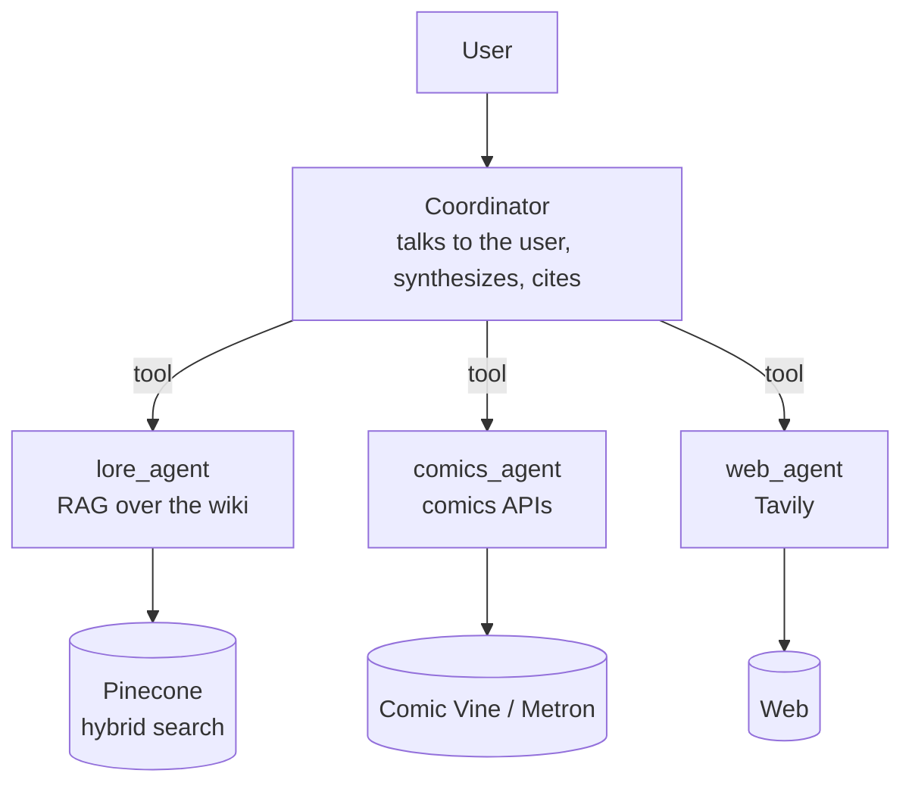
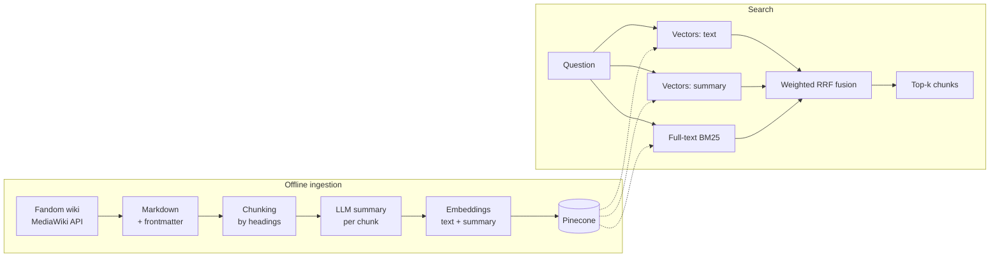

# SIKTC
## Something Is Killing the Chatbot

> *"There are monsters in those scripts."*

A multi-agent RAG system about the world of **Something Is Killing the Children**, the horror comic by James Tynion IV and Werther Dell'Edera, and its spin-offs (House of Slaughter, Hello Darkness, the *Book of* one-shots).

This is a learning project. It starts with **LangChain** and grows in stages with **LangGraph** and **Deep Agents**. Each stage replaces the internals of the orchestration but keeps the data, the contracts and the evaluation unchanged, so every version can be compared on the same numbers.

---

## What it does

- **Answers questions about plot, characters, monsters and places** from a knowledge base built from the series wiki.
- **Avoids spoilers.** You tell it how far you have read in each series, and it leaves out content from story arcs you haven't finished.
- **Cites its sources.** Every answer says which wiki page, API or website the information came from.
- **Combines three sources in a fixed order of trust**: canonical lore first, then issue metadata, then the web. When the web contradicts the wiki, the wiki wins.

## Architecture



The coordinator is the only agent that talks to the user. The subagents are exposed as tools and return structured output (`answer`, `sources`, `confidence`). The coordinator doesn't know how they work inside, which is what makes it possible to rewrite them in LangGraph or Deep Agents without touching anything else.

### RAG pipeline



**Ingestion**

1. **Collection.** Pages are downloaded through the wiki's MediaWiki API and saved as raw HTML. Downloads are incremental: only pages with a new revision are fetched again.
2. **Conversion.** HTML becomes Markdown with its headings preserved. The infobox goes into the frontmatter as structured data, and tables are rebuilt and also exported as CSV.
3. **Chunking.** Text is split by headings (`#`, `##`, `###`), short sections are merged, and tables are split by rows with the header repeated in each piece. Every chunk starts with its section path (`[Erica Slaughter > History > Early life]`).
4. **Issue ranges.** `series`, `issue_min` and `issue_max` are extracted from the infobox (`Originally published in: … #11–15`) and drive the spoiler guard.
5. **Summaries.** An LLM writes a summary for each chunk that resolves pronouns and vague references, using the whole document as context.
6. **Indexing.** Pinecone allows only one dense vector per schema, so the two embeddings live in two namespaces of the same index: `chunks` (chunk text, plus the full-text fields) and `summaries` (summary).

**Search**

Three searches run in parallel: vector search on `chunks`, vector search on `summaries`, and full-text BM25. The results are merged with **weighted Reciprocal Rank Fusion**: each vector list counts half, so semantic search doesn't get two votes against BM25. The spoiler guard is a metadata filter applied to all three searches.

## Project structure

```
something_is_killing_the_chatbot/
|
├── scripts/
    ├── data_collector.py # wiki -> raw HTML -> Markdown with frontmatter
    
├── src/
│   ├── ingestion/
│   │   ├── chunk.py              # chunking, metadata, issue ranges
│   │   └── summary.py            # per-chunk summaries and embeddings (JSONL, resumable)
│   ├── retrieval/
│   │   ├── utils.py             # functions for pinecone
│   │   └── pinecone_retrieval.py # Pinecone index, hybrid search, spoiler guard
│   └── utils/
│       └── retry_decorators.py
├── collection/                      # generated data, not tracked by git
│   ├── raw/                         # raw HTML, one file per page
│   ├── siktc/                       # Markdown with frontmatter
│   ├── tables/                      # tables as CSV
│   └── siktc_with_summaries.jsonl   # produced by summary.py
├── pyproject.toml
└── .env                             # API keys, not tracked by git
```

## Installation

Requires [uv](https://docs.astral.sh/uv/) and Python 3.12.

```bash
git clone https://github.com/GioSira/something_is_killing_the_chatbot.git
cd something_is_killing_the_chatbot
uv sync
```

The project is installed in editable mode, so the packages in `src/` can be imported from any folder.

Create a `.env` file in the project root:

```env
OPENROUTER_API_KEY=...

PINECONE_API_KEY=...
PINECONE_CLIENT_ID=...

TAVILY_API_KEY=...

LANGSMITH_API_KEY=...
LANGSMITH_TRACING=true
LANGSMITH_ENDPOINT=https://eu.api.smith.langchain.com
LANGSMITH_AGENT_ID=...
LANGSMITH_AGENT_ENVIRONMENT=...
```

Search with the spoiler guard:

```python
from retrieval.pinecone_retrieval import PineconeRetriever, spoiler_filter
from ingestion.summary import get_embeddings

query = "Who is Octos?"
async with PineconeRetriever() as retriever:
    results = await retriever.search_chunks_hybrid(
        "siktc",
        query_vector=get_embeddings([query])[0],
        query_text=query,
        top_k=20,
        filter=spoiler_filter({"Something Is Killing the Children": 20}),
    )
```

## Models

| Role | Model |
|---|---|
| Chunk summaries | `qwen/qwen3.7-flash` via OpenRouter, temperature 0, reasoning off |
| Embeddings | `openai/text-embedding-3-small` (1536 dimensions) |

Summaries and embeddings are computed once, at ingestion time. Processing the whole corpus (about 400 chunks) costs a few cents.

## Roadmap

**Stage 1: LangChain**
- [x] Wiki collection and conversion to structured Markdown
- [x] Heading-based chunking with metadata and issue ranges
- [x] Per-chunk summaries and embeddings
- [x] Pinecone index with hybrid search and weighted RRF
- [x] Spoiler guard on metadata
- [ ] Candidate reranking and chunk relevance grading
- [ ] Queryable publication table (issue release timeline)
- [ ] `lore_agent`, `comics_agent` and `web_agent` subagents, coordinator built with `create_agent`
- [ ] Evaluation dataset (recall@5, answer faithfulness) on LangSmith

**Stage 2: LangGraph**
- [ ] Corrective RAG as a graph: retrieve, grade, rewrite the query, fall back to the web
- [ ] Postgres checkpointer, long-term memory, human-in-the-loop for web searches

**Stage 3: Deep Agents**
- [ ] Coordinator with planning and subagents
- [ ] Vector RAG compared with agentic search over the filesystem (`grep`, `read_file`)

## Data and licensing

The text comes from the [Something Is Killing the Children Wiki](https://something-is-killing-the-children.fandom.com/) on Fandom, licensed under **CC BY-SA**. Every chunk keeps its `source_url` so answers can credit the original page. Generated data is not included in the repository; the ingestion scripts recreate it.

*Something Is Killing the Children*, its characters and related trademarks belong to their creators and BOOM! Studios. This is a hobby and learning project with no affiliation to them.
